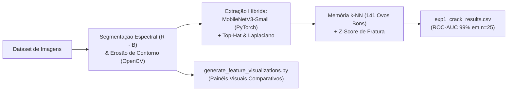

# 🥚 Egg Outlier Detection (Detecção de Ovos Anômalos)

Sistema de visão computacional e aprendizado de máquina (*One-Class Learning*) para triagem e controle de qualidade de ovos na indústria avícola, focado na detecção automatizada de **rachaduras e quebras estruturais** na casca.

---

## 📊 Evolução Experimental e Resultados Principais

O projeto é conduzido como um **experimento científico iterativo**. O modelo atual utiliza aprendizado de uma única classe (*One-Class Anomaly Detection*), treinando **exclusivamente com ovos íntegros** ($n = 141$) e avaliando a capacidade de generalização em conjuntos independentes de validação ($n = 25$: 20 bons + 5 trincados) e teste ($n = 25$: 20 bons + 5 trincados):

| Etapa | Modelo / Workflow | Dataset e Divisão (*Split*) | Resultados e Métricas | Status |
| :--- | :--- | :--- | :--- | :--- |
| **Baseline Clássico** | Limiarização Otsu Cinza + Percentil 2% | 200 fotos (v1, sem separação treino/teste) | Falhou em **56,5%** das segmentações; confundiu orientação da foto com deformação. | ❌ Descartado |
| **Autoencoder Tabular** | Segmentação Espectral ($R-B$) + `MLPRegressor` (`17->10->4->10->17`) | 192 fotos (treino apenas em ovos normais) | Segmentação **100%** eficaz (**97,45% ROC-AUC** tabular), mas pintinhas naturais da casca se confundiam com trincas. | ⚠️ Parcial (Motivou isolar trincas de pintinhas) |
| **Exp 1A (CNN Puro)** | `SmallConvAutoencoder` (CNN treinada do zero em PyTorch + `EarlyStopping`) | **Treino:** 141 Bons<br>**Val:** 20 Bons + 5 Trincados ($n=25$)<br>**Teste:** 20 Bons + 5 Trincados ($n=25$) | `Val AUROC` estabilizou em **75,00%** (Época 22). Com 141 fotos não-estáticas, uma CNN do zero tem capacidade limitada para microtrincas finas. | ⚠️ Limitado isoladamente |
| **Exp 1B (Atual)** | **`MobileNetV3-Small` (*Deep Embeddings* k-NN estilo *PatchCore*) + Descritores Morfológicos (*Top-Hat* + *Laplaciano*)** | **Banco de Memória:** 141 Bons<br>**Val:** 20 Bons + 5 Trincados ($n=25$)<br>**Teste:** 20 Bons + 5 Trincados ($n=25$) | **Validação ($n=25$):** `ROC-AUC = 88,00%`, `Recall = 100%` (5/5)<br>**Teste ($n=25$):** **`ROC-AUC = 99,00%`**, `Acurácia = 92,00%`, `F1 = 83,33%`, **`Recall = 100%` (5/5)**.<br>Detectou **10 de 10** ovos trincados! | ✅ **Sucesso (Pipeline Principal)** |

> **Nota sobre Transparência Estatística e Próximos Passos:** O índice de **99,00% de ROC-AUC (100% de Recall)** no Experimento 1B foi obtido sobre um conjunto de teste inicial controlado de **$n = 25$ imagens** (20 ovos íntegros e 5 ovos trincados). Este resultado valida o pipeline híbrido (*Deep Embeddings* + Morfologia) como prova de conceito antes da expansão para a Coleta v2 (câmera estática e rotação multi-ângulo). Consulte o arquivo [`SPECS.md`](SPECS.md) para o detalhamento metodológico completo.

---

## 📌 Visão Geral da Arquitetura

O repositório contempla tanto o **pipeline principal de detecção de rachaduras (*One-Class*)** quanto os módulos exploratórios de extração de features tabulares:



### 1. Segmentação Robusta e Isolamento de ROI (`extract_features.py` / `workflow_exp1_crack_detector.py`)
- **Separação Espectral ($R - B$):** Isolação robusta da casca do ovo eliminando superfícies de apoio (ex: mousepad azul) e elementos externos sem depender de fundos monocromáticos puros.
- **Invariância à Rotação da Câmera:** Cálculo de *Aspect Ratio* e *Excentricidade* através do ajuste de elipse (`cv2.fitEllipse`), garantindo que fotos tiradas em orientação horizontal ou vertical não causem falsos positivos.
- **Análise Interna de Casca (Erosão de Borda):** A máscara do contorno é erodida para evitar que o perímetro externo ou sombras da borda sejam confundidos com trincas.
- **Compensação de Iluminação 3D:** Remoção do gradiente esférico da lâmpada via filtragem residual local.

### 2. Detecção Híbrida de Rachaduras — *One-Class Learning* (`workflow_exp1_crack_detector.py`)
- **Deep Feature Memory Bank (`MobileNetV3-Small`):** Extração de *embeddings* profundos pré-treinados na ImageNet comparados via distância *k-NN* ($k=5$) exclusivamente contra o banco de memória de ovos íntegros (abordagem inspirada no *PatchCore*).
- **Descritores Morfológicos de Fratura:** Filtro morfológico *Black Top-Hat* (`cv2.MORPH_BLACKHAT`) para realçar fendas escuras estreitas, energia de alta frequência do Laplaciano (`cv2.Laplacian`), perda de solidez estrutural do contorno e razão de membrana branca exposta.
- **Autoencoder Convolucional (`SmallConvAutoencoder`):** Rede neural convolucional treinada do zero com parada antecipada (`EarlyStopping`) monitorando o `Val AUROC` a cada época.

### 3. Baseline Estatístico e Tabular (`detect_outliers.py` & `train_neural_network.py`)
- **Critério de Tukey (IQR) & Isolation Forest:** Análise exploratória univariada e multivariada (`scikit-learn`) sobre descritores geométricos e de textura.
- **Autoencoder Tabular & MLP:** Rede neural densa sobre 17 features tabulares (`97,45% de ROC-AUC` no experimento preliminar).

---

## 🛠️ Tecnologias Utilizadas

- **Python 3.10+**
- **PyTorch & Torchvision**: `MobileNetV3-Small` (*Feature Extractor*), `SmallConvAutoencoder` e controle de *Early Stopping*.
- **OpenCV (`cv2`)**: Processamento de imagem, segmentação espectral ($R-B$), transformações morfológicas (*Top-Hat*) e ajuste geométrico.
- **Scikit-Learn**: Métricas de validação (`roc_auc_score`, `f1_score`), `NearestNeighbors` (*k-NN*), `IsolationForest` e `RobustScaler`.
- **Pandas, NumPy & Matplotlib**: Vetorização, cálculo estatístico e geração de painéis visuais de inspeção.

---

## 🚀 Como Executar

### 1. Instalar dependências
```bash
pip install -r requirements.txt
```

### 2. Executar o Workflow Principal de Detecção de Rachaduras (Exp 1A + Exp 1B)
```bash
python workflow_exp1_crack_detector.py
```
> Executa o treinamento do `SmallConvAutoencoder` com *Early Stopping* e avalia o detector híbrido `MobileNetV3-Small` + Morfologia nos conjuntos de validação ($n=25$) e teste ($n=25$), salvando as predições detalhadas em `exp1_crack_results.csv`.

### 3. Gerar Painéis Visuais Comparativos das Features
```bash
python generate_feature_visualizations.py
```
> Gera na pasta `Visualizacao_Features/` os painéis lado a lado comparando como cada filtro (máscara espectral $R-B$, *Black Top-Hat*, energia Laplaciana e *Z-Score*) responde a ovos íntegros vs. ovos trincados.

### 4. Executar os Módulos Exploratórios Tabulares (Opcional)
```bash
python extract_features.py
python detect_outliers.py
python train_neural_network.py
```

---

## 📁 Estrutura do Repositório

```text
├── .gitignore                          # Protege dados brutos e fotos privadas
├── requirements.txt                    # Dependências do projeto
├── README.md                           # Documentação principal e resultados
├── SPECS.md                            # Especificações técnicas, escopo One-Class e diário de experimentos
├── workflow_exp1_crack_detector.py     # Pipeline principal: CNN Autoencoder + MobileNetV3 k-NN & Morfologia
├── generate_feature_visualizations.py  # Geração de painéis visuais explicativos (Ovo Bom vs. Quebrado)
├── exp1_crack_results.csv              # Resultados e scores de anomalia de Validação (n=25) e Teste (n=25)
├── extract_features.py                 # Extração de 17 features tabulares (Dataset autoral)
├── extract_supervised_features.py      # Extração de features para Ovoscopia e Kaggle Dataset
├── detect_outliers.py                  # Algoritmos estatísticos (IQR) e Isolation Forest
├── train_neural_network.py             # Treinamento de Rede Neural Tabular (Autoencoder + MLP)
├── egg_features.csv                    # Características extraídas (Dataset autoral)
├── candling_features.csv               # Características extraídas (Ovoscopia - 1.000 ovos)
├── kaggle_features.csv                 # Características extraídas (Kaggle - 794 ovos)
├── outliers_summary.csv                # Relatório detalhado dos outliers tabulares
├── nn_predictions.csv                  # Predições e erros de reconstrução da Rede Neural Tabular
└── egg_neural_network.pkl              # Pesos salvos da Rede Neural Tabular
```

> **Nota sobre o Dataset:** Conforme diretrizes de privacidade e propriedade da amostra, o conjunto de imagens brutas (`Dataset/`, `Outliers_Encontrados/` e `Visualizacao_Features/`) está protegido e omitido do versionamento através do `.gitignore`.
