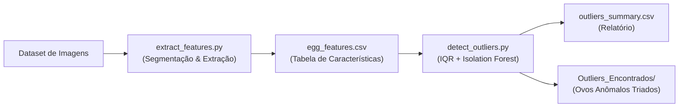

# 🥚 Egg Outlier Detection (Detecção de Ovos Anômalos)

Sistema de visão computacional e aprendizado de máquina para triagem e controle de qualidade de ovos, detectando anomalias estruturais, cromáticas e de textura (trincas, rachaduras, manchas, despigmentação e deformações de formato).

---

## 📌 Visão Geral da Arquitetura

O pipeline é dividido em duas etapas modulares e desacopladas:



### 1. Segmentação Robusta e Extração (`extract_features.py`)
- **Separação Espectral ($R - B$):** Isolação robusta da casca do ovo eliminando superfícies de apoio (ex: mousepad azul) e elementos externos (toalhas, mesas claras e suportes plásticos) sem depender de fundos monocromáticos puros.
- **Invariância à Rotação da Câmera:** Cálculo de *Aspect Ratio* e *Excentricidade* através do ajuste de elipse (`cv2.fitEllipse`), garantindo que fotos tiradas em orientação horizontal ou vertical não causem falsos positivos.
- **Análise Interna de Casca (Erosão de Borda):** A máscara do contorno é erodida para evitar que o perímetro externo ou sombras da borda sejam confundidos com trincas.
- **Compensação de Iluminação 3D:** Remoção do gradiente esférico da lâmpada via filtragem residual local, isolando manchas, sardas e sujeiras reais na casca.

### 2. Detecção de Outliers e Anomalias (`detect_outliers.py`)
- **Critério de Tukey (IQR):** Análise univariada interpretável para limites físicos anômalos ($Q_3 + 1.5 \times IQR$ ou $Q_1 - 1.5 \times IQR$):
  - `MANCHAS_OU_SARDAS`
  - `TRINCA_OU_TEXTURA_IRREGULAR`
  - `FORMATO_MUITO_COMPRIDO`
  - `DEFORMACAO_CONTORNO`
  - `PIGMENTACAO_PALIDA`
- **Isolation Forest (Multivariado):** Modelo de aprendizado não-supervisionado (`scikit-learn`) que avalia combinações anômalas em espaço multidimensional normalizado com `RobustScaler`.
- **Relatório Consolidado:** Geração automática do arquivo `outliers_summary.csv` contendo o índice de anomalia e a justificativa física de cada ovo classificado.

---

## 🛠️ Tecnologias Utilizadas

- **Python 3.10+**
- **OpenCV (`cv2`)**: Processamento de imagem, segmentação morfológica e ajuste geométrico.
- **Scikit-Learn**: Algoritmo Isolation Forest e escalonamento robusto.
- **Pandas & NumPy**: Vetorização, cálculo estatístico e manipulação de dados tabulares.

---

## 🚀 Como Executar

### 1. Instalar dependências
```bash
pip install -r requirements.txt
```

### 2. Extrair características das imagens
Coloque as fotos dos ovos na pasta `Dataset/` e execute:
```bash
python extract_features.py
```
> Isso gerará o arquivo `egg_features.csv` com as métricas de cada imagem.

### 3. Detectar anomalias e gerar relatório
```bash
python detect_outliers.py
```
> As anomalias encontradas serão listadas no terminal, salvas em `outliers_summary.csv` e copiadas para a pasta `Outliers_Encontrados/` com os respectivos prefixos de classificação.

### 4. Treinar a Rede Neural (Autoencoder + MLP Classificadora)
```bash
python train_neural_network.py
```
> Treina uma Rede Neural Autoencoder não-supervisionada (`17 -> 10 -> 4 -> 10 -> 17`, atingindo **97,45% de ROC-AUC**) e uma Rede Neural Densa `MLPClassifier` (`17 -> 64 -> 32 -> 1`, atingindo **92,71% de acurácia** em validação cruzada de 5 folds), gerando `nn_predictions.csv` e `egg_neural_network.pkl`.

---

## 📁 Estrutura do Repositório

```text
├── .gitignore                      # Protege dados brutos e fotos privadas
├── requirements.txt                # Dependências do projeto
├── README.md                       # Documentação técnica
├── extract_features.py             # Pipeline de segmentação e extração (Dataset autoral)
├── extract_supervised_features.py  # Extração de features para Ovoscopia e Kaggle Dataset
├── detect_outliers.py              # Algoritmos estatísticos (IQR) e Isolation Forest
├── train_neural_network.py         # Treinamento de Rede Neural (Autoencoder + MLP)
├── egg_features.csv                # Características extraídas (Dataset autoral)
├── candling_features.csv           # Características extraídas (Ovoscopia - 1.000 ovos)
├── kaggle_features.csv             # Características extraídas (Kaggle - 794 ovos)
├── outliers_summary.csv            # Relatório detalhado dos outliers detectados
├── nn_predictions.csv              # Predições e erros de reconstrução da Rede Neural
└── egg_neural_network.pkl          # Pesos salvos da Rede Neural treinada
```

> **Nota sobre o Dataset:** Conforme diretrizes de privacidade e propriedade da amostra, o conjunto de imagens brutas (`Dataset/` e `Outliers_Encontrados/`) está protegido e omitido do versionamento através do `.gitignore`.
