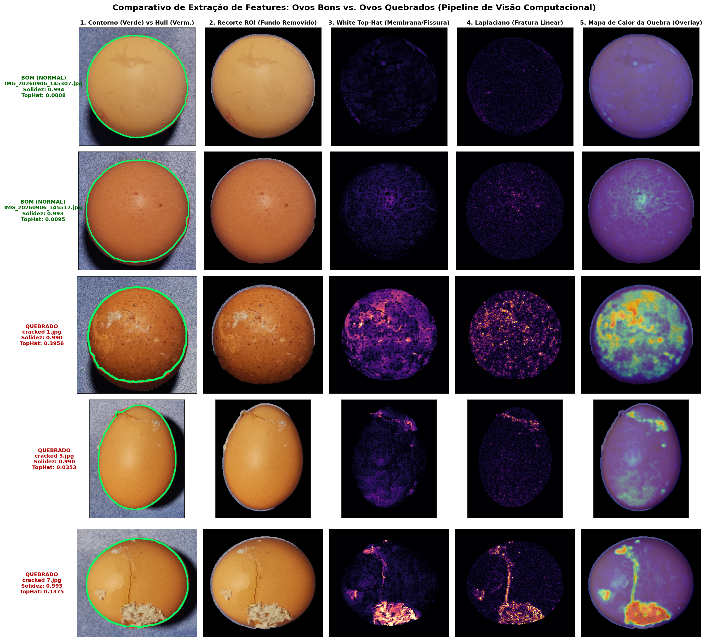
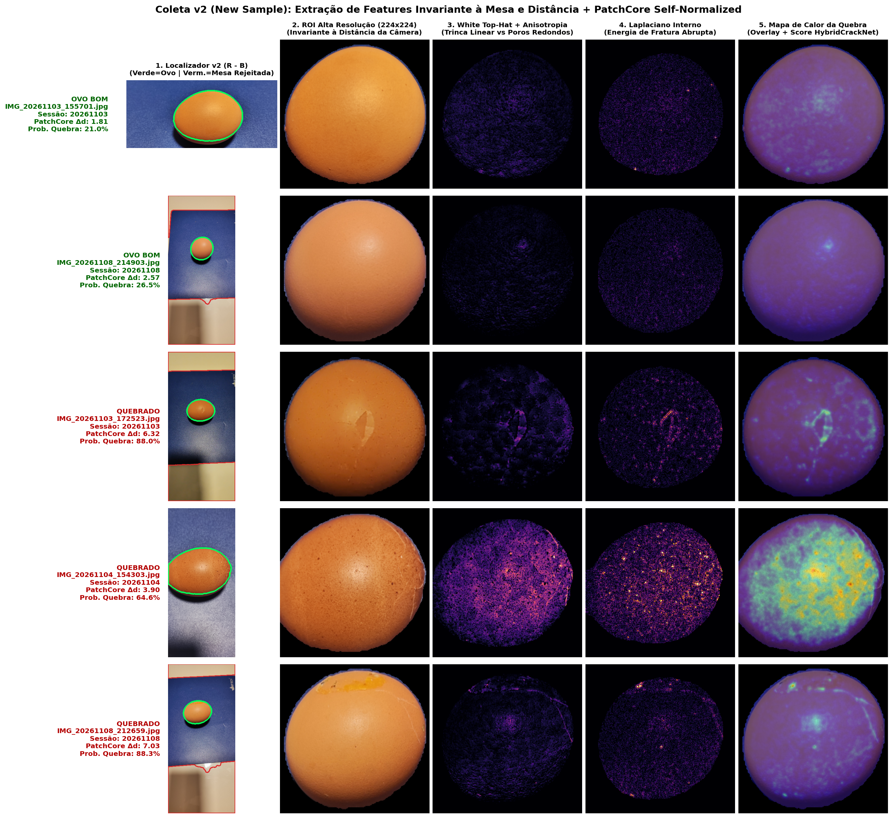
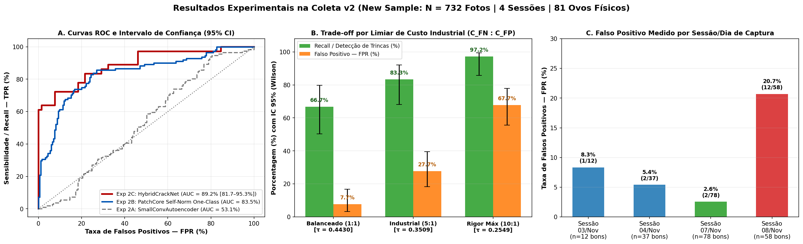
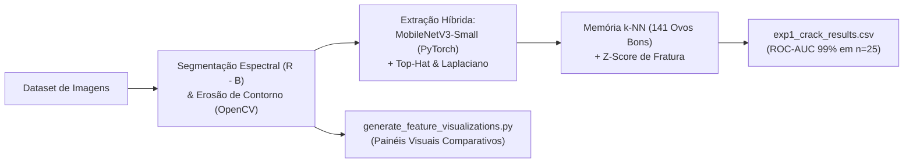

# 🥚 Egg Outlier Detection (Detecção de Ovos Anômalos)

Sistema de visão computacional e aprendizado de máquina (*One-Class Learning*) para triagem e controle de qualidade de ovos na indústria avícola, focado na detecção automatizada de **rachaduras e quebras estruturais** na casca.

---

## 📊 Evolução Experimental e Resultados Principais

O projeto é conduzido como um **experimento científico iterativo**. O modelo atual utiliza aprendizado de uma única classe (*One-Class Anomaly Detection*), treinando **exclusivamente com ovos íntegros** ($n = 141$) e avaliando a capacidade de generalização em conjuntos independentes de validação ($n = 25$: 20 bons + 5 trincados) e teste ($n = 25$: 20 bons + 5 trincados):

| Etapa | Modelo / Workflow | Dataset e Divisão (*Split*) | Resultados e Métricas | Status |
| :--- | :--- | :--- | :--- | :--- |
| **Baseline Clássico** | Limiarização Otsu Cinza + Percentil 2% | 200 fotos (v1, sem separação treino/teste) | Falhou em **56,5%** das segmentações; confundiu orientação da foto com deformação. | ❌ Descartado |
| **Autoencoder Tabular** | Segmentação Espectral ($R-B$) + `MLPRegressor` (`17->10->4->10->17`) | 192 fotos (treino apenas em ovos normais) | Segmentação **100%** eficaz (**97,45% ROC-AUC** tabular), mas pintinhas naturais da casca se confundiam com trincas. | ⚠️ Parcial (Motivou isolar trincas de pintinhas) |
| **Exp 1A (CNN Puro)** | `SmallConvAutoencoder` (CNN treinada do zero em PyTorch + `EarlyStopping`) | **Treino:** 141 Bons<br>**Val:** 20 Bons + 5 Trincados ($n=25$)<br>**Teste:** 20 Bons + 5 Trincados ($n=25$) | `Val AUROC` estabilizou em **75,00%** (Época 22). Com 141 fotos não-estáticas, uma CNN do zero tem capacidade limitada para microtrincas finas. | ⚠️ Limitado isoladamente |
| **Exp 1B (Coleta v1)** | `MobileNetV3-Small` (*Deep Embeddings* k-NN) + Morfologia (*Top-Hat* + *Laplaciano*) | **Banco de Memória:** 141 Bons<br>**Val:** 20 Bons + 5 Trincados ($n=25$)<br>**Teste:** 20 Bons + 5 Trincados ($n=25$) | **Validação ($n=25$):** `ROC-AUC = 88,00%`, `Recall = 100%` (5/5)<br>**Teste ($n=25$):** `ROC-AUC = 99,00%`, `Acurácia = 92,00%`, `Recall = 100%` (5/5). | ✅ Prova de Conceito v1 |
| **Exp 2B (Coleta v2 — One-Class)** | **`Self-Normalized Spatial PatchCore`** (`MobileNetV3-Large` + `ResNet18` $28\times 28$, $\Delta d_p = d_p - \text{mediana}(d)$) + Anisotropia (`max_elongation`) | **732 fotos únicas (`New sample/`)** em 4 sessões (`03`, `04`, `07`, `08/Nov`) e 81 grupos físicos:<br>**Treino:** 436 Bons (0 Trincados)<br>**Val:** 120B + 49Q ($n=169$)<br>**Teste:** 65B + 62Q ($n=127$) | **Validação:** `ROC-AUC = 86,09%` (95% CI: `[79,4%, 92,0%]`)<br>**Teste:** `ROC-AUC = 80,72%` (95% CI: `[72,2%, 88,3%]`)<br>**Global (111 Quebrados):** **`ROC-AUC = 83,47%`** (`[78,7%, 88,3%]`). Subtrair a mediana intra-ovo neutraliza falsos positivos causados pela porosidade da casca! | ✅ **Sucesso One-Class v2** |
| **Exp 2C (Coleta v2 — Híbrido Calibrado)** | **`HybridCrackNet`** (Fusão `PatchCore` + `Deep MLP` com `EarlyStopping`) + **Calibração por Custo Industrial ($C_{FN}:C_{FP}$)** | **732 fotos (`New sample/`)** sem vazamento entre ângulos do mesmo ovo:<br>**Treino:** 436B + 49Q<br>**Val:** 120B + 26Q ($n=146$)<br>**Teste:** 65B + 36Q ($n=101$) | **Validação:** **`ROC-AUC = 91,09%`** (95% CI: `[84,2%, 96,5%]`)<br>**Teste:** **`ROC-AUC = 89,19%`** (95% CI: `[81,7%, 95,3%]`)<br>• **Custo 1:1 ($\tau=0,4430$):** `FPR = 7,7%`, `Recall = 66,7%`, `F1 = 73,8%`<br>• **Custo 5:1 ($\tau=0,3509$):** `Recall = 83,3%`, `FPR = 27,7%`<br>• **Custo 10:1 ($\tau=0,2549$):** **`Recall = 97,2%` (35/36)**, `FPR = 67,7%`. | ✅ **Melhor Modelo Atual** |

> **Nota sobre Transparência Estatística e Evolução para a Coleta v2:** O índice de **99,00% de ROC-AUC (100% de Recall)** no Experimento 1B foi obtido sobre um conjunto de teste inicial controlado de **$n = 25$ imagens** (20 ovos íntegros e 5 ovos trincados). A partir do feedback técnico de especialistas da área (sobre intervalo de confiança em amostras pequenas, separação por sessão de captura, porosidade superficial e calibração por custo industrial), o projeto avançou para a **Coleta v2 (`New sample/` com $N = 732$ fotos únicas: 621 ovos bons e 111 ovos quebrados em 4 sessões e 81 grupos físicos)**. Consulte [`SPECS.md`](SPECS.md) e [`RELATORIO_PROFESSOR_EXP2.md`](RELATORIO_PROFESSOR_EXP2.md) para o detalhamento completo.

---

## 🖼️ Comparativo Geral: Antes (Coleta v1) vs. Depois (Coleta v2)

### 1. Antes — Experimento 1 (Coleta v1: $N = 191$ fotos, Quebras Severas, Extração Global)


### 2. Depois — Experimento 2 (Coleta v2: $N = 732$ fotos, Rejeição de Mesa, Recorte Nativo e PatchCore Self-Normalized)


### 3. Painel de Métricas do Experimento 2 (Curvas ROC com IC 95%, Matriz de Custo e FPR por Sessão)


---

## 🔍 Análise Técnica: O que mudou, o que foi feito e por que foi feito

| Dimensão | Como era Antes (Coleta v1 — Exp 1) | O que mudou / O que foi feito (Coleta v2 — Exp 2) | Por que foi feito? (Motivação Técnica e Industrial) |
| :--- | :--- | :--- | :--- |
| **1. Volume de Dados e Divisão Anti-Vazamento** | 191 fotos (181 bons e **10 quebrados**), divididas por imagem individual (`5` quebrados na Validação e `5` no Teste). | **732 fotos únicas** (**621 bons e 111 quebrados** — aumento de **11,1x** nos quebrados) em **4 sessões/dias** (`03`, `04`, `07` e `08/Nov`). Criado agrupamento por **Ovo Físico (`egg_group_id` via $|\Delta t| \le 25\text{s}$)** em 81 grupos independentes + deduplicação por hash MD5. | Com apenas 5 ovos quebrados no teste, o Recall de 100% tinha um Intervalo de Confiança de 95% de Wilson largo ($[56,6\%, 100\%]$). Além disso, como cada ovo foi fotografado girando em vários ângulos, agrupar por ovo físico garante **vazamento zero** entre treino e teste. |
| **2. Localizador do Ovo (`locate_and_crop_egg_v2`)** | Selecionava o maior contorno (`max(contours, key=cv2.contourArea)`) na imagem reduzida para `600px`. | Adicionada **rejeição de faixas de borda externa (`wb > 0.92 * rw`)**, ponderação por **centralidade espacial (`cv2.moments`)** e **recorte direto na resolução nativa (12 MP)** antes de converter para `224x224` (**100% de acerto nas 732 fotos**). | Na Coleta v2, fotos tiradas mais de longe mostravam a **mesa bege** fora do tapete azul (que também tem $R > B$ e era capturada em 70% das fotos pelo critério antigo). E recortar na foto original impede que microtrincas capilares sumam ao reduzir a imagem inteira. |
| **3. Representação Neural (`MobileNetV3` Global $\rightarrow$ Espacial $28\times 28$)** | `MobileNetV3-Small` com **Global Average Pooling** (1 vetor médio de `576` dimensões por ovo). | Evoluído para **Extração Espacial por Patches ($28\times 28$)** combinando camadas intermediárias da **`MobileNetV3-Large` + `ResNet18`** (`Self-Normalized Spatial PatchCore`, **Exp 2B**) e fusão com rede densa regularizada (**`HybridCrackNet`**, **Exp 2C** com `EarlyStopping`). | Na Coleta v2, a maioria das rachaduras são **microtrincas capilares finas** ($<1\%$ da área da casca). Tirar a média do ovo inteiro diluía a trinca nos 99% de casca normal. Olhando uma grade de $28\times 28$ pedacinhos (*patches*), a rede isola exatamente o local da microtrinca. |
| **4. Supressão de Falso Positivo por Porosidade da Casca** | Distância *k-NN* absoluta + *Top-Hat* global. | Subtração da **mediana intra-ovo das distâncias dos patches** ($\Delta d_p = d_p - \text{mediana}_{q \in \text{Ovo}}(d_q)$) + **Alongamento Anisotrópico (`max_elongation`)** via `cv2.connectedComponentsWithStats`. | Ovos de diferentes sessões/lotes têm cascas naturalmente mais porosas. Subtrair a mediana do próprio ovo anula a rugosidade basal do lote, e o filtro de anisotropia separa poros redondos ($\text{Elongation} \approx 2\text{–}9$) de trincas lineares ($\text{Elongation} > 13$). |
| **5. Limiar de Anomalia ($\tau$) por Custo Industrial e FPR por Sessão** | Limiar único fixado no F1 máximo da validação, sem estratificação por sessão. | Calibração explícita pela **Matriz de Custo Industrial ($\mathcal{L}(\tau) = C_{FN}\cdot\text{FNR} + C_{FP}\cdot\text{FPR}$)** nos regimes **$1:1$**, **$5:1$** e **$10:1$**, mais relatório de **Falso Positivo por Sessão (`exp2_session_fpr_summary.csv`)**. | Na granja, deixar passar um ovo trincado ($C_{FN}$) tem risco sanitário/comercial muito maior que desviar um ovo bom para indústria líquida ($C_{FP}$). E medir o FPR por sessão provou baixa taxa nas sessões diurnas (**2,6% a 8,3%**) vs. sessão noturna (**20,7%**), fundamentando o uso futuro de câmera e luz estáticas. |

---

## 📌 Visão Geral da Arquitetura

O repositório contempla tanto o **pipeline principal de detecção de rachaduras (*One-Class*)** quanto os módulos exploratórios de extração de features tabulares:



### 1. Segmentação Robusta e Isolamento de ROI (`extract_features.py` / `workflow_exp1_crack_detector.py`)
- **Separação Espectral ($R - B$):** Isolação robusta da casca do ovo eliminando superfícies de apoio (ex: mousepad azul) e elementos externos sem depender de fundos monocromáticos puros.
- **Invariância à Rotação da Câmera:** Cálculo de *Aspect Ratio* e *Excentricidade* através do ajuste de elipse (`cv2.fitEllipse`), garantindo que fotos tiradas em orientação horizontal ou vertical não causem falsos positivos.
- **Análise Interna de Casca (Erosão de Borda):** A máscara do contorno é erodida para evitar que o perímetro externo ou sombras da borda sejam confundidos com trincas.
- **Compensação de Iluminação 3D:** Remoção do gradiente esférico da lâmpada via filtragem residual local.

### 2. Detecção Híbrida de Rachaduras — *One-Class Learning* (`workflow_exp1_crack_detector.py`)
- **Deep Feature Memory Bank (`MobileNetV3-Small`):** Extração de *embeddings* profundos pré-treinados na ImageNet comparados via distância *k-NN* ($k=5$) exclusivamente contra o banco de memória de ovos íntegros (abordagem inspirada no *PatchCore*).
- **Descritores Morfológicos de Fratura:** Filtro morfológico *Black Top-Hat* (`cv2.MORPH_BLACKHAT`) para realçar fendas escuras estreitas, energia de alta frequência do Laplaciano (`cv2.Laplacian`), perda de solidez estrutural do contorno e razão de membrana branca exposta.
- **Autoencoder Convolucional (`SmallConvAutoencoder`):** Rede neural convolucional treinada do zero com parada antecipada (`EarlyStopping`) monitorando o `Val AUROC` a cada época.

### 3. Baseline Estatístico e Tabular (`detect_outliers.py` & `train_neural_network.py`)
- **Critério de Tukey (IQR) & Isolation Forest:** Análise exploratória univariada e multivariada (`scikit-learn`) sobre descritores geométricos e de textura.
- **Autoencoder Tabular & MLP:** Rede neural densa sobre 17 features tabulares (`97,45% de ROC-AUC` no experimento preliminar).

---

## 🛠️ Tecnologias Utilizadas

- **Python 3.10+**
- **PyTorch & Torchvision**: `MobileNetV3-Small` (*Feature Extractor*), `SmallConvAutoencoder` e controle de *Early Stopping*.
- **OpenCV (`cv2`)**: Processamento de imagem, segmentação espectral ($R-B$), transformações morfológicas (*Top-Hat*) e ajuste geométrico.
- **Scikit-Learn**: Métricas de validação (`roc_auc_score`, `f1_score`), `NearestNeighbors` (*k-NN*), `IsolationForest` e `RobustScaler`.
- **Pandas, NumPy & Matplotlib**: Vetorização, cálculo estatístico e geração de painéis visuais de inspeção.

---

## 🚀 Como Executar

### 1. Instalar dependências
```bash
pip install -r requirements.txt
```

### 2. Executar o Workflow Principal na Coleta v2 (`New sample/` — Exp 2A, 2B e 2C)
```bash
python workflow_exp2_new_sample.py
```
> Processa as 732 imagens únicas da pasta `New sample/` (distribuídas em 4 sessões de captura e agrupadas em 81 ovos físicos para evitar vazamento entre rotações), executa o `SmallConvAutoencoder` (Exp 2A), o `Self-Normalized Spatial PatchCore` (Exp 2B) e o `HybridCrackNet` (Exp 2C) com *Early Stopping*, calcula os Intervalos de Confiança de 95% (Wilson/Bootstrap), calibra os limiares ($\tau$) por custo industrial ($1:1$, $5:1$ e $10:1$) e salva `exp2_new_sample_results.csv` e `exp2_session_fpr_summary.csv`.

### 3. Executar o Workflow da Coleta v1 (`Dataset/` — Exp 1A + Exp 1B)
```bash
python workflow_exp1_crack_detector.py
```
> Executa o benchmark inicial sobre o `Dataset/` ($n=191$), salvando as predições em `exp1_crack_results.csv`.

### 4. Gerar Painéis Visuais Comparativos das Features (Coleta v2 e Coleta v1)
```bash
python generate_exp2_visualizations.py
python generate_feature_visualizations.py
```
> Gera os painéis visuais comparativos lado a lado e os gráficos de resultados (`Visual/Comparativo_New_Sample_Professor.png`, `Visual/Graficos_Resultados_Exp2_Professor.png` e `Visual/Comparativo_Geral.png`).

### 5. Executar os Módulos Exploratórios Tabulares (Opcional)
```bash
python extract_features.py
python detect_outliers.py
python train_neural_network.py
```

---

## 📁 Estrutura do Repositório

```text
├── .gitignore                          # Protege dados brutos e pastas de fotos privadas
├── requirements.txt                    # Dependências do projeto
├── README.md                           # Documentação principal, comparativo Antes/Depois e resultados
├── SPECS.md                            # Especificações técnicas, escopo One-Class e diário de experimentos
├── RELATORIO_PROFESSOR_EXP2.md         # Relatório técnico-científico detalhado do Experimento 2
├── workflow_exp2_new_sample.py         # Pipeline v2 (732 fotos): PatchCore 28x28 + HybridCrackNet + Custo
├── generate_exp2_visualizations.py     # Geração das pranchas comparativas v2 e gráficos ROC/Custo/Sessão
├── exp2_new_sample_results.csv         # Scores e predições das 732 imagens nos limiares 1:1, 5:1 e 10:1
├── exp2_session_fpr_summary.csv        # Taxa de Falsos Positivos (FPR) e Recall por sessão de captura
├── workflow_exp1_crack_detector.py     # Pipeline v1 (191 fotos): CNN Autoencoder + MobileNetV3 Global
├── generate_feature_visualizations.py  # Geração de painéis visuais explicativos da Coleta v1
├── exp1_crack_results.csv              # Resultados de Validação (n=25) e Teste (n=25) da Coleta v1
├── Visual/                             # Pranchas comparativas gerais (Antes v1, Depois v2 e Gráficos)
│   ├── Comparativo_Geral.png
│   ├── Comparativo_New_Sample_Professor.png
│   └── Graficos_Resultados_Exp2_Professor.png
├── extract_features.py                 # Extração de 17 features tabulares (Dataset autoral)
├── extract_supervised_features.py      # Extração de features para Ovoscopia e Kaggle Dataset
├── detect_outliers.py                  # Algoritmos estatísticos (IQR) e Isolation Forest
├── train_neural_network.py             # Treinamento de Rede Neural Tabular (Autoencoder + MLP)
├── egg_features.csv                    # Características extraídas (Dataset autoral)
├── candling_features.csv               # Características extraídas (Ovoscopia - 1.000 ovos)
├── kaggle_features.csv                 # Características extraídas (Kaggle - 794 ovos)
├── outliers_summary.csv                # Relatório detalhado dos outliers tabulares
├── nn_predictions.csv                  # Predições e erros de reconstrução da Rede Neural Tabular
└── egg_neural_network.pkl              # Pesos salvos da Rede Neural Tabular
```

> **Nota sobre Privacidade do Dataset:** Conforme diretrizes estritas do projeto, **nenhuma pasta de dados brutos ou fotos individuais** (`Dataset/`, `New sample/`, `Outliers_Encontrados/`, `Visualizacao_Features/`, `Kaggle Dataset/`, `Original Images(Eggs)/`, `Augmented_Images(Eggs)/`) é enviada ao GitHub, estando bloqueadas no `.gitignore`. Apenas as 3 pranchas sintéticas comparativas em `Visual/` são versionadas para documentação no `README.md`.
